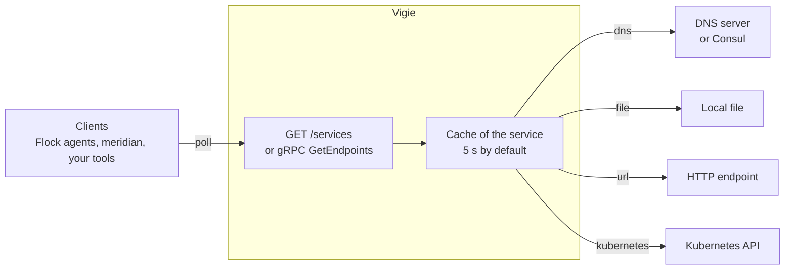

Vigie sits between the places where the endpoints of your services are listed and the clients that need them, such as
load balancers and proxies. Each service of its configuration has a name and one source. A client asks for a service by
name, and Vigie answers with the endpoints the source gives, in one JSON format whatever the source.



## Services and sources

A service has a name and one source. The name is what clients send in `service_name`. A request without a name gets the
service named `default`, when the file has one.

The source says where the endpoints come from:

| Source | Reads | Weight of the endpoints |
|---|---|---|
| `dns` | The A and AAAA records of a name, its SRV records, or its TXT records starting with `eds=` | The weight of the SRV record, else `0`, or the weight of the TXT line |
| `file` | A local file, one endpoint per line | The weight of the line, else `0` |
| `url` | The body of an HTTP `GET`, one endpoint per line | The weight of the line, else `0` |
| `kubernetes` | The ready endpoints of the EndpointSlices of a Service | Always `0` |

Consul has no source of its own because it answers DNS for its services, so the `dns` source reads it. [Read Consul
services](/guides/read-consul-services/) shows how.

A service holds one source. When a service sets several, the first of `kubernetes`, `url`, `file` and `dns` wins, and
Vigie ignores the others.

An endpoint that gives no port takes the `default_port` of the service, `80` when the service sets none. Files, remote
lists and TXT records share one line format, described in [Endpoint lines](/reference/configuration/#endpoint-lines).

## The answer

Every service answers `GET /services?service_name=<name>` with a JSON list of objects. Each object is one endpoint:

```json
[
  {
    "ip": "10.0.0.7",
    "port": 8080,
    "load_balancing_weight": 3
  }
]
```

The fields and the `service_name` parameter are a contract with the clients. The agents of Flock read this answer for
their backends with an `eds` block, and meridian reads it too, so a change to them is a change to those clients as well.

Vigie never resolves a host name it finds in a line, so the `ip` of a file or a remote list is what the line says. Write
IP addresses there, because a client such as the Flock agent refuses an `ip` that isn't one.

The same endpoints come from the gRPC service `vigie.eds.v1.EndpointDiscoveryService` too, on the same port, for clients
that prefer typed messages to JSON. Both read the same services through the same cache.

[HTTP API](/reference/http-api/) lists every endpoint of the server and its errors, the gRPC service included.

## The cache

Vigie keeps the answer of each source for a while instead of reading the source on every request. The time is
`cache.ttl` of the file, 5 seconds by default, and a service can set its own `cache_ttl`. `0s` turns the cache off for
the service. A change to the records, the file, the remote list or the pods shows within that time, without a reload.

- When the answer has expired, the requests that arrive wait for one read of the source and share its result. Many
  clients polling at once cost one lookup.
- A read that fails isn't kept, so the next request reads the source again, and a source back up after an outage is seen
  at once.

Pick the time against the refresh rate of your clients. A cache longer than the interval at which the clients poll only
delays the changes they see.

## Reload

The services of the file can change without a restart. `SIGHUP` or `POST /reload` reads the file again and swaps all the
services at once, so a request sees either the old services or the new ones, never a mix. A reload empties the cache.

When the new file is invalid, or one of its sources can't be built, Vigie keeps every service it had and reports the
error, in its logs and in the answer of `POST /reload`. A reload replaces `services`, with the `cache.ttl` they take. A
change to `server` or `log` needs a restart, and so does a change to `disable_reload_by_request`.

[Reload the services](/guides/reload-the-services/) gives the commands.

## The page

The root of the server, `/`, is a page that lists the services with their source and fetches their endpoints from
`/services` when it loads. It's meant for a person checking what Vigie serves, see [Web page](/reference/web-page/).
